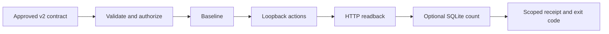

# OutcomeLab evidence matrix

Baseline: `265bed86737c23d0462310b4ccfaa94de7338f3b`. The baseline run on Windows with Python 3.14.3 passed repository validation and all 36 tests. Both legacy SQLite cases returned DEMONSTRATED. The installed CLI checked all three HTTP contracts twice per reference variant.

| README claim | Code | Reproduction and expected evidence | Limits |
| --- | --- | --- | --- |
| The CLI checks webhook idempotency, invoice persistence, and inventory reservations | [HTTP runner](../risk_lab/http_verify.py), [contracts](../examples/http/v2/) | `python -m unittest discover -s tests -p test_stateful_http.py -v`; the installed CLI repeats broken FAIL and fixed PASS for each unchanged contract | Sequential disposable loopback fixtures |
| An optional read-only SQLite witness catches a duplicate hidden by API readback | [Witness](../risk_lab/sqlite_witness.py), [reference server](../risk_lab/demo_http.py) | `python -m unittest discover -s tests -p test_sqlite_witness.py -v`; `test_deceptive_http_pass_needs_database_witness` shows all HTTP assertions passing on both variants and the witness failing only on broken | One operator-approved count over a rollback-journal file, no deployment attestation |
| An integer sum detects a wrong persisted amount even with the correct row count | [SQLite witness](../risk_lab/sqlite_witness.py) | `test_correct_count_cannot_hide_wrong_integer_amount` runs the same webhook contract on live broken and corrected variants | Exact integer total, not per-row equality for multiple rows |
| The witness cannot silently fall back to HTTP | [Witness and verdict integration](../risk_lab/http_verify.py) | `test_invalid_or_unavailable_witness_stops_before_requests` and `test_unavailable_final_witness_cannot_pass` | A proven HTTP failure can skip witness readback |
| Contracts can be validated offline | [CLI](../risk_lab/cli.py) | `test_validate_has_no_network_or_subprocess` | Valid syntax does not prove correct expectations |

The [validation workflow](../.github/workflows/validate.yml) installs the CLI on Windows and Ubuntu with Python 3.11 and 3.12. Read the check run attached to the commit under review for observed status and tested SHA.

## Architecture and scope

The run ID binds the baseline and final checks to the authorized test resource. HTTP is the service's report. SQLite reads a separate backing-store interface under operator control. Receipts identify both sources when used.

Delivered slice: optional SQLite row counts, mixed-evidence verdicts, interrupted-write reporting, and backend agent guidance. Planned: broader HTTP authoring, concurrency, async polling, queue and state-machine packs, external databases, and additional agent integrations. No outside adoption was measured.
